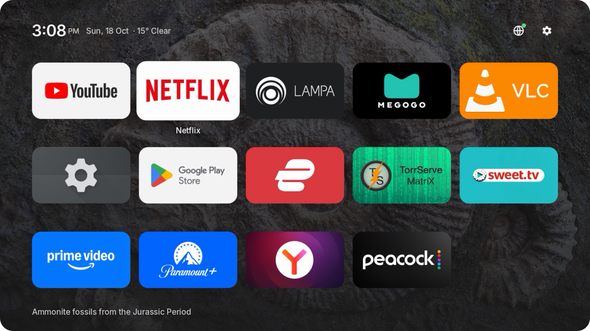
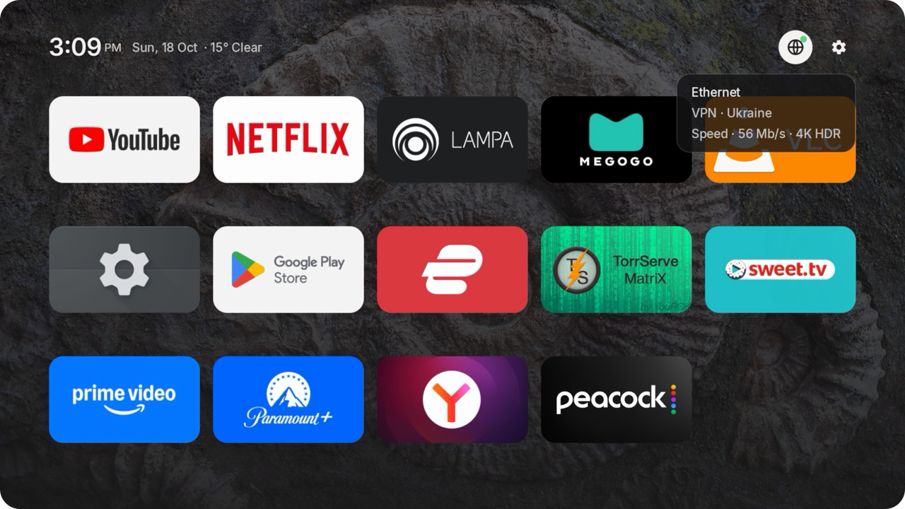

# Lil Launcher

A tiny home screen for Android TV and Google TV that borrows its manners from tvOS. Your apps sit on a photo, and that's it. There are no ads or sponsored rows, and nobody gets to decide what you should watch next.

I built it for my NVIDIA Shield because I wanted the TV to feel like an Apple TV without buying one. It's plain Android Views with one dependency, and the APK is under 1 MB.

[](https://github.com/thevrus/lil-launcher/releases/latest)

[](LICENSE)



## What's in it

- The backdrop is Bing's photo of the day. Each one is toned down so the tiles stay readable, and it changes on the hour.
- Apps are sorted by how long you actually use them (foreground time over the last 30 days). Hold Select on a tile to move it or hide it.
- The header shows the time, the date and the weather from Open-Meteo, and slides away when you scroll.
- Focus the globe to see your connection, which country your VPN exits in, and a quick speed test that tells you whether 4K will hold up.
- The screensaver shows the same photos full screen, drifting slowly, with the time and the place name.
- On TV sets with HDMI ports, an Inputs button lists them, along with whatever is plugged in. Boxes like the Shield never see it.
- Hold Select on the gear to put the TV to sleep.

It doesn't use Leanback or Compose and has no analytics. It only goes online for the photo, the weather and the network info you ask for.

| Network | Screensaver |
| --- | --- |
|  |  |

## Debloat your TV too

A clean home screen only goes so far if the system underneath keeps phoning home. [DEBLOAT.md](DEBLOAT.md) is the rest of what I did to my Shield. It covers why it's worth the fifteen minutes, which packages are safe to turn off on Google TV, Shield, Sony and TCL, and a prompt you can paste into Claude Code (or any coding assistant) to have it do the work for you. Every step can be undone.

## Works on

Any Android TV or Google TV device on Android 9 or later should work: NVIDIA Shield, Chromecast with Google TV, Google TV Streamer, Sony and TCL sets, Xiaomi Mi Box, onn. 4K. I use it every day on a Shield; the others are untested, so issues are welcome.

Fire TV won't work, because Amazon doesn't let other apps take over the Home button.

## Install

1. Download `lil-launcher.apk` from the [latest release](https://github.com/thevrus/lil-launcher/releases/latest).
2. Enable **Developer options > USB / network debugging** on the TV, then from a computer:

```sh
adb connect <tv-ip>:5555
adb install lil-launcher.apk
adb shell cmd package set-home-activity dev.vr.tvlaunch/.MainActivity
```

3. Optional one-time grants, for ranking by use, the screensaver and sleep:

```sh
adb shell appops set dev.vr.tvlaunch GET_USAGE_STATS allow
adb shell settings put secure screensaver_components dev.vr.tvlaunch/dev.vr.tvlaunch.Screensaver
adb shell pm grant dev.vr.tvlaunch android.permission.WRITE_SECURE_SETTINGS
```

Without adb, sideload the APK with an app such as Downloader or Send Files to TV, then press Home and pick Lil Launcher. Without the grants, apps are ranked by how often you launch them from Lil Launcher.

Android resets the Home choice on every update, so run `set-home-activity` again after installing a new version. To go back, run it with your old launcher's component, which `adb shell cmd package query-activities --brief -a android.intent.action.MAIN -c android.intent.category.HOME` lists.

## Build

JDK 17 and the Android SDK:

```sh
./gradlew assembleRelease
```

## Credits

Photos from Bing's homepage archive, owned by their photographers. Weather by [Open-Meteo](https://open-meteo.com). Inter typeface under the SIL Open Font License (`OFL-Inter.txt`). Not affiliated with Apple, Google or NVIDIA.

Code under the [MIT License](LICENSE).
