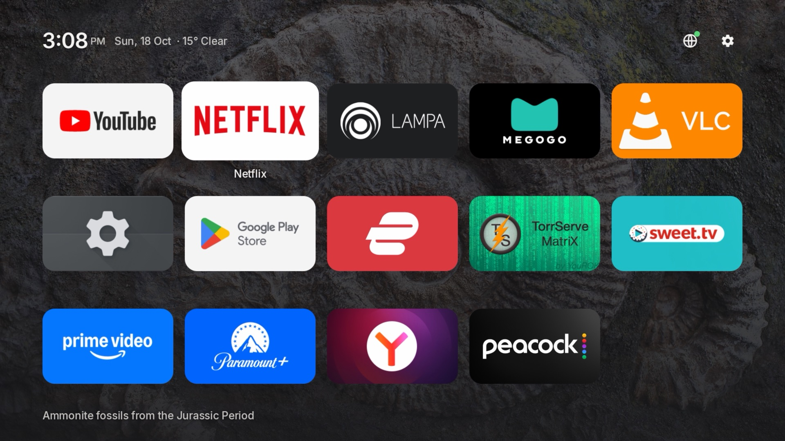
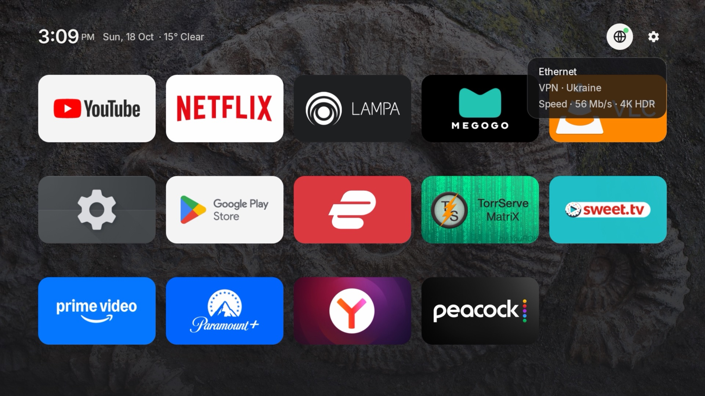

# Lil Launcher

**A tiny, tvOS-inspired home screen for Android TV and Google TV.** No ads, no recommendation rows, no sponsored content: just your apps on a beautiful photo. Plain Views, one dependency, under 1 MB.

[](https://github.com/thevrus/lil-launcher/releases/latest)

[](LICENSE)



## Features

- **Photo of the day** from Bing as the backdrop, desaturated and dimmed per photo so the tiles stay readable. It changes on the hour.
- **Apps by real use.** Ranked by foreground time over 30 days. Hold Select on a tile to move or hide it.
- **Quiet header.** Time, date and current weather (Open-Meteo, no API key). It fades away as you scroll.
- **Network at a glance.** Focus the globe for connection type, VPN exit country and a quick speed test with the video quality it supports.
- **Screensaver.** The same photos full screen, with a slow drift, the time and the place name.
- **Sleep** from the gear menu (hold Select on the gear).
- **Lightweight.** No Leanback, no Compose, no tracking. Network work only happens when it is needed.

| Network | Screensaver |
| --- | --- |
|  |  |

## Works on

Any Android TV or Google TV device on Android 9 or later: NVIDIA Shield, Chromecast with Google TV, Google TV Streamer, Sony and TCL TVs, Xiaomi Mi Box, onn. 4K and more. Tested daily on an NVIDIA Shield.

Fire TV is not supported: Fire OS does not let third-party apps replace the home screen.

## Install

1. Download `lil-launcher.apk` from the [latest release](https://github.com/thevrus/lil-launcher/releases/latest).
2. Enable **Developer options > USB / network debugging** on the TV, then from a computer:

```sh
adb connect <tv-ip>:5555
adb install lil-launcher.apk
adb shell cmd package set-home-activity dev.vr.tvlaunch/.MainActivity
```

3. Optional one-time grants, for ranking by use, the screensaver and sleep:

```sh
adb shell appops set dev.vr.tvlaunch GET_USAGE_STATS allow
adb shell settings put secure screensaver_components dev.vr.tvlaunch/dev.vr.tvlaunch.Screensaver
adb shell pm grant dev.vr.tvlaunch android.permission.WRITE_SECURE_SETTINGS
```

Without adb, sideload the APK with an app such as Downloader or Send Files to TV, then press Home and pick Lil Launcher. Without the grants, apps are ranked by how often you launch them from Lil Launcher.

Android resets the Home choice on every update, so run `set-home-activity` again after installing a new version. To go back, run it with your old launcher's component, which `adb shell cmd package query-activities --brief -a android.intent.action.MAIN -c android.intent.category.HOME` lists.

## Build

JDK 17 and the Android SDK:

```sh
./gradlew assembleRelease
```

## Credits

Photos from Bing's homepage archive, owned by their photographers. Weather by [Open-Meteo](https://open-meteo.com). Inter typeface under the SIL Open Font License (`OFL-Inter.txt`). Not affiliated with Apple, Google or NVIDIA.

Code under the [MIT License](LICENSE).
